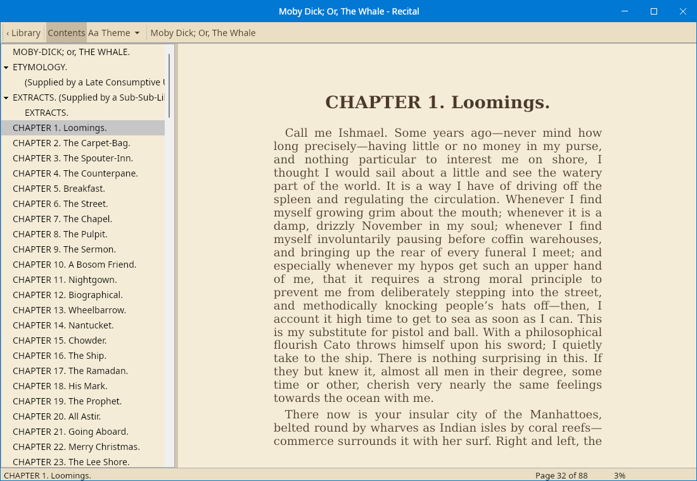
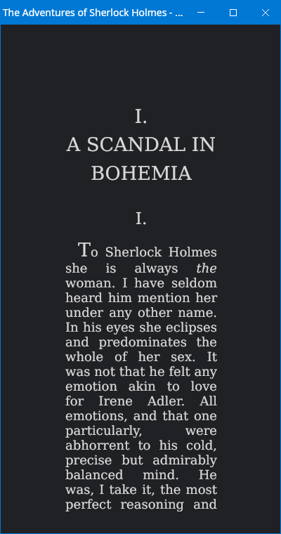
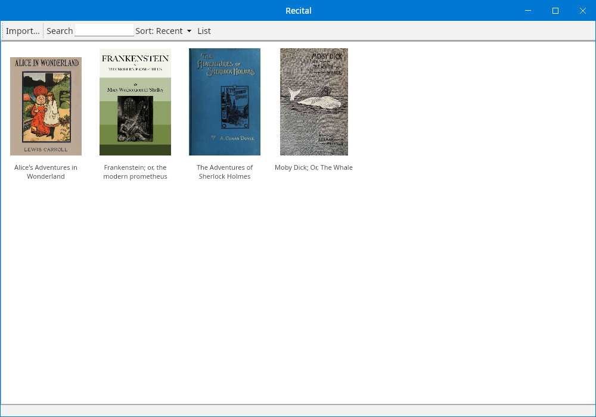

# Recital

A cross-platform EPUB reader built on [Majorsilence.Forms](https://forms.majorsilence.com). Your library
and reading position sync through your own cloud storage (Google Drive, Dropbox, OneDrive, WebDAV,
iCloud Drive or any synced folder), with no server and no accounts. Text-to-speech aims to sound like a
person reading.

Recital is also a deliberate workout for Majorsilence.Forms: every framework rough edge it hits is
logged in [docs/FRAMEWORK_GAPS.md](docs/FRAMEWORK_GAPS.md).

<p>
  
  
</p>
<p>
  
</p>

Screenshots are Headless renders of Project Gutenberg books from the test corpus;
`RECITAL_SCREENSHOTS=1 dotnet test tests/Majorsilence.Recital.UI.Tests --filter ScreenshotTests` redraws them.

Status: Phase 6 done. The library, reading positions, highlights, notes and bookmarks sync through any
shared folder on the desktop (Library > Sync > Choose sync folder…). The reader UI's manual desktop
check on Windows, macOS and Linux is still to do. Next is Phase 7 (cloud providers). See [docs/PLAN.md](docs/PLAN.md) and [CHANGELOG.md](CHANGELOG.md).

## Build

```bash
dotnet build Majorsilence.Recital.slnx -c Release
dotnet test Majorsilence.Recital.slnx -c Release
dotnet run --project hosts/Majorsilence.Recital.Desktop
```

- **Android:** with the `android` workload installed the head builds automatically; force it with
  `-p:EnableAndroidHead=true`. Without the workload it builds as an empty stub. The build also needs
  the Android SDK and a JDK. If you have neither, this installs both into your home directory
  (it accepts the Android SDK licenses); then set `ANDROID_HOME` and `JAVA_HOME` to the same paths:
  ```bash
  dotnet build hosts/Majorsilence.Recital.Android -t:InstallAndroidDependencies -f net10.0-android \
    -p:EnableAndroidHead=true -p:AndroidSdkDirectory=$HOME/Android/Sdk \
    -p:JavaSdkDirectory=$HOME/.jdk/microsoft-17 -p:AcceptAndroidSDKLicenses=True
  ```
- **iOS:** macOS only. `dotnet build hosts/Majorsilence.Recital.iOS -p:EnableIOSHead=true`.
- **Browser:** builds with no workload. Running it needs native Skia linked into the WASM bundle,
  which needs the `wasm-tools` workload: `dotnet publish hosts/Majorsilence.Recital.Browser -c Release`.
- **UI baselines:** one PNG per OS. `RECITAL_UPDATE_BASELINES=1 dotnet test tests/Majorsilence.Recital.UI.Tests`
  rewrites this OS's baselines. For the other OSes, CI uploads mismatched renders as artifacts.
  Review a PNG before committing it. See `docs/DECISIONS.md` D-006.

## License

MIT. Third-party licenses are in [THIRD_PARTY.md](THIRD_PARTY.md).
